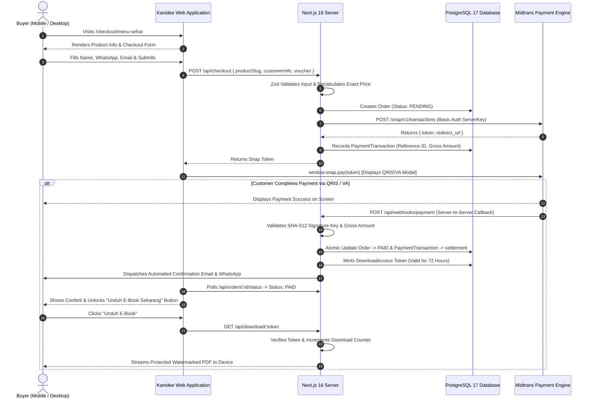

# BSD: Business System Design & Product Specification
**Project Name:** Kanidee Platform (Digital Health E-Commerce & Content Ecosystem)  
**Document Identifier:** KND-BSD-001  
**Version:** 2.0.0-ENTERPRISE  
**Date:** October 2026  
**Author Role:** Senior Principal Product Architect & Business Systems Specialist  
**Classification:** Confidential / Client Engineering Specification  

---

## 1. Executive Summary & Problem Formulation

### 1.1 Business Context & Problem Statement
The Kanidee wellness brand currently distributes its digital products (nutrition e-books, dietary curricula, training modules, and herbal formulas) via third-party micro-storefront aggregation platforms, specifically `lynk.id/kanidee`. 

While micro-storefront aggregators serve entry-level creators, they present critical structural deficiencies for a growing commercial enterprise:
1. **Brand Erosion & Third-Party Domain Dependency:** Every marketing campaign on Instagram, TikTok, or Meta Ads directs prospective clients to a third-party domain (`lynk.id/kanidee/...`). This dilutes brand authority, weakens corporate trust, and prevents Kanidee from cultivating domain-level search engine dominance (SEO).
2. **Platform Commission Tolls:** Third-party aggregators extract ongoing percentage-based transaction fees and monthly recurring subscription costs on top of the payment gateway processing fees.
3. **Rigid Viewport Limitations:** Lynk.id is strictly constrained to a narrow, mobile-only card layout. When accessed via desktop or tablet devices, the page appears squashed and amateurish, failing to engage high-value desktop shoppers.
4. **Disjointed Content & Commerce:** The existing setup cannot host full-length educational articles, diet guides, or interactive nutritional calculators, forcing the brand to fragment its content across external blogging channels or social media captions.
5. **Lack of Customer Data Ownership:** Customer purchase histories, retention metrics, and lead lists are trapped inside a third-party walled garden, preventing direct remarketing, automated retention sequences, and unified CRM integration.

### 1.2 The Solution: The Autonomous Kanidee Platform
Kanidee will transition to a dedicated, high-performance web platform featuring:
- Autonomous brand identity on a custom domain (e.g., `kanidee.com`).
- Direct checkout parity and superiority compared to lynk.id (instant checkout per product slug without forced account creation).
- Direct native integration with Indonesia's primary payment gateway infrastructure (Midtrans Snap: QRIS 2.0, Virtual Accounts, E-Wallets).
- Unified multi-section architecture delivering the 6 client-specified functional menus: **Home**, **Menu Product**, **Menu Artikel**, **Menu Download**, **CMS (Admin)**, and **Menu Profil**.
- Automated digital fulfillment with time-expiring signed download tokens and dynamic buyer watermarking to eliminate piracy.

---

## 2. Competitive & Operational Gap Analysis

| Feature Dimension | Lynk.id (`lynk.id/kanidee`) | Kanidee Autonomous Platform |
|---|---|---|
| **Domain Ownership** | Subordinated (`lynk.id/kanidee`) | 100% Owned (`kanidee.com` or `kanidee.id`) |
| **Transaction Fees** | Gateway Fee + Platform Commission (2% - 5%) | Gateway Fee Only (0.7% for QRIS, Rp 0 platform cut) |
| **Desktop Responsiveness** | Poor (Centred mobile iframe emulator) | Adaptive Full-Width Responsive (320px to 3840px 4K) |
| **Direct Product Checkout** | URL-based (`lynk.id/.../checkout`) | Native Slug-based (`kanidee.com/checkout/:slug`) |
| **Content Publishing** | Limited to basic link labels | Full SEO-Engineered Article Blog (`/artikel`) |
| **Digital Asset Delivery** | Generic file download link | Secure, Expiring Tokenized PDF with Dynamic Buyer Watermark |
| **Customer Retention & Leads**| Platform-owned contact data | Dedicated Database Ownership + Automated WhatsApp/Email |
| **Administrative Control** | Vendor-locked settings | Bespoke CMS Backoffice (`/cms`) with Analytics |
| **Visual Aesthetics** | Generic template cards | Impeccable Craft UI, Organic Wellness Design System |

---

## 3. Comprehensive Specification of the 6 Mandated User Menus

```
┌─────────────────────────────────────────────────────────────────────────────────┐
│                           KANIDEE SITE MAP & ROUTING                            │
├─────────────────────┬───────────────────────────────────────────────────────────┤
│ 1. Home             │ • Hero Brand Proposition & Value Statements               │
│    (/ & /links)     │ • Bio-Link Tree (Social Media Aggregator)                 │
│                     │ • Featured Digital Product Cards with Quick Buy           │
│                     │ • Educational Articles Carousel Preview                   │
│                     │ • Verified Client Transformations & Social Proof          │
├─────────────────────┼───────────────────────────────────────────────────────────┤
│ 2. Menu Product     │ • Full Product Catalog Overview (/produk)                 │
│    (/produk)        │ • Product Sales Deep-Dive Pages (/produk/:slug)           │
│    (/checkout)      │ • Frictionless Direct Checkout (/checkout/:slug)          │
│                     │ • Real-time Midtrans Snap Modal (QRIS, VA, E-Wallet)      │
├─────────────────────┼───────────────────────────────────────────────────────────┤
│ 3. Menu Artikel     │ • Categorized Blog Archive (/artikel)                     │
│    (/artikel)       │ • Article Reading View (/artikel/:slug)                   │
│                     │ • Estimated Reading Time & Author Attribution             │
│                     │ • In-Article Conversion CTAs Leading to E-Book Checkout   │
├─────────────────────┼───────────────────────────────────────────────────────────┤
│ 4. Menu Download    │ • Self-Service Order Lookup Form (/download)              │
│    (/download)      │ • Tokenized Download Portal (/download/:token)            │
│                     │ • Anti-Piracy Watermarking & 72-Hour Expiration Counter   │
├─────────────────────┼───────────────────────────────────────────────────────────┤
│ 5. CMS (Admin)      │ • Secure JWT Cookie Authentication (/cms/login)           │
│    (/cms)           │ • Executive Dashboard: Daily Gross Revenue & Order Stats  │
│                     │ • Product Catalog Manager (CRUD, Pricing, PDF Upload)     │
│                     │ • Article Publisher (Rich-Text, Categories, SEO Meta)     │
│                     │ • Transaction Monitoring & Midtrans Reconciliation        │
│                     │ • Voucher & Promo Code Engine                             │
│                     │ • Brand Profile & Site Settings Configuration             │
├─────────────────────┼───────────────────────────────────────────────────────────┤
│ 6. Menu Profil      │ • Practitioner/Trainer Background & Health Philosophy     │
│    (/profil)        │ • Certified Accreditations & Holistic Wellness Method     │
│                     │ • Direct Click-to-Chat WhatsApp Consultation Funnel       │
└─────────────────────┴───────────────────────────────────────────────────────────┘
```

---

### 3.1 Menu 1: Home (`/` and `/links`)

#### Purpose & Strategic Objective
The Home interface acts as the master landing environment and first point of contact for visitors arriving from Instagram, TikTok, Facebook Ads, or word-of-mouth recommendations. It must establish instant credibility, highlight core offerings, and provide a dedicated bio-link route (`/links`) that completely replaces lynk.id.

#### Functional Requirements:
1. **Hero Section:**
   - Primary Headline: *"Edukasi & Panduan Praktis Kesehatan Holistik Paripurna"*.
   - Sub-headline detailing the twin benefits of sustainable personal health transformation and affiliate/education opportunities.
   - Primary Action Button: *"Lihat Program & E-Book"* (Smooth scrolls to Catalog or routes to `/produk`).
   - Secondary Action Button: *"Konsultasi WhatsApp"* (Direct deeplink to WhatsApp Business with pre-filled greeting).
2. **Bio-Link Aggregator (`/links`):**
   - High-speed, lightweight link list designed specifically for Instagram/TikTok bio URLs.
   - Features prominent avatar/logo, verified badge, quick social icon bar, and tappable cards for active programs:
     - *"Panduan Menu Diet Sehat"* -> `/checkout/menu-diet`
     - *"Program Pelatihan Menu Sehat"* -> `/checkout/menu-sehat`
     - *"Paket Herbal & Panduan Maduka"* -> `/checkout/maduka`
     - *"Baca Artikel Edukasi Nutrisi"* -> `/artikel`
     - *"Hubungi Trainer via WhatsApp"* -> `https://wa.me/...`
3. **Featured Digital Products Showcase:**
   - Three-card responsive grid highlighting the flagship products with pricing, short benefit bullet points, and direct *"Beli Sekarang"* buttons.
4. **Latest Educational Insights:**
   - Dynamically pulls the 3 most recently published articles from **Menu Artikel**.
   - Displays cover photo, category badge (e.g. *Pola Makan*, *Diet Pemula*, *Herbal*), title, and reading time.
5. **Verified Client Social Proof & Testimonials:**
   - Real before/after case studies, verified testimonial quotes, and participant feedback ratings.
6. **Global Trust Footer:**
   - Copyright notice, disclaimer regarding health advice, quick links to Privacy Policy (`/kebijakan-privasi`), Terms of Service (`/syarat-ketentuan`), and secure payment badge icons (QRIS, GPN, BCA, Mandiri, BNI, BRI, GoPay).

---

### 3.2 Menu 2: Menu Product (`/produk` and `/checkout/:slug`)

#### Purpose & Strategic Objective
To provide a frictionless digital storefront that lets prospective buyers review product details and immediately purchase their desired e-book or curriculum without confusing multistep funnels.

#### Functional Requirements:
1. **Catalog Overview Page (`/produk`):**
   - Category filtering pills: *Semua Produk*, *E-Book Panduan*, *Program Pelatihan*, *Paket Herbal*.
   - Search bar filtering by product title or keyword.
   - Product cards showing thumbnail, title, badge, current price, strikethrough comparison price (showing savings), and rating score.
2. **Product Sales Detail Page (`/produk/:slug`):**
   - Dynamic URL structure based on product slug (e.g., `/produk/menu-sehat`, `/produk/maduka`).
   - Editorial long-form copy explaining:
     - What the buyer receives (PDF guide, printable meal planner, video tutorials).
     - Who this program is designed for (and who it is NOT for).
     - Full table of contents / chapter breakdown.
     - Frequently Asked Questions (FAQ) accordion.
   - Prominent Sticky CTA Bar on mobile devices containing price and *"Beli Sekarang"* button.
3. **Direct Checkout Flow (`/checkout/:slug`):**
   - Direct purchase parity: A user clicking a campaign link like `/checkout/menu-sehat` lands directly on the checkout screen without having to navigate through intermediate cart pages.
   - **Customer Information Fields:**
     - Full Name (Mandatory, sanitized for watermark printing).
     - WhatsApp Phone Number (Mandatory, validated for Indonesian formats `08...`, `+628...`).
     - Email Address (Mandatory, verified via standard RFC-5322 regex).
     - Customer Notes (Optional special requests).
   - **Order Summary Component:**
     - Item title and thumbnail.
     - Base price, discount breakdown, and final total in IDR.
     - Voucher code input with real-time validation against the `/api/voucher/verify` endpoint.
   - **Payment Execution:**
     - Tapping *"Bayar Sekarang"* triggers a server action creating a pending order and generating a Midtrans Snap Token.
     - Launches the native Midtrans Snap UI popup directly within the viewport.
     - Customer chooses between QRIS 2.0 (instant scan via any banking app or e-wallet), Virtual Account (BCA, Mandiri, BRI, BNI), or E-Wallet (GoPay, ShopeePay).

---

### 3.3 Menu 3: Menu Artikel (`/artikel` and `/artikel/:slug`)

#### Purpose & Strategic Objective
To serve as an organic traffic engine and educational authority hub, converting search engine queries and curious social readers into paying e-book customers through valuable, scientifically grounded wellness advice.

#### Functional Requirements:
1. **Blog Index (`/artikel`):**
   - Featured article hero spot with large editorial photography.
   - Category navigation: *Nutrisi & Pola Makan*, *Panduan Diet*, *Herbal Alami*, *Gaya Hidup Sehat*.
   - Grid cards displaying thumbnail, publication date formatted in Indonesian locale (`29 Oktober 2026`), category tag, title, 2-line excerpt, and estimated reading time (calculated dynamically: $\approx \text{words} / 200$).
2. **Article Reader View (`/artikel/:slug`):**
   - Fully optimized typography adhering to the `pbakaus/impeccable` readability standard (max-w-prose, 150% line height, comfortable font sizing).
   - Semantic HTML5 structure (`<article>`, `<header>`, `<main>`, `<aside>`) with Schema.org `Article` structured data for Google Rich Results.
   - Sticky social share buttons (WhatsApp, Telegram, Twitter/X, Copy Link).
   - **Embedded In-Article Conversion Modules:**
     - Mid-article banner matching the article's topic. For example, an article discussing *"Cara Mengatur Kalori Harian"* embeds a direct call-to-action card: *"Ingin menu diet terstruktur siap saji selama 30 hari? Dapatkan E-Book Menu Diet Sehat sekarang"* with an instant checkout button.
   - Related articles carousel at the conclusion of the reading experience.

---

### 3.4 Menu 4: Menu Download (`/download` and `/download/:token`)

#### Purpose & Strategic Objective
To provide an automated, self-service digital asset delivery portal. Customers who purchase e-books or guides can retrieve their digital files at any time without manual staff intervention on WhatsApp.

#### Functional Requirements:
1. **Self-Service Order Lookup (`/download`):**
   - Input form requesting:
     - Order Number (e.g. `KND-20261029-4821`).
     - WhatsApp Phone Number registered during checkout.
   - On submission, verifies the credentials against the database. If the order is paid, displays the customer's digital product library with active download links.
2. **Tokenized Download Access (`/download/:token`):**
   - Each completed order generates a cryptographically random UUID token associated with the specific purchased product.
   - **Access Rules & Anti-Piracy Governance:**
     - **Time Expiration:** Token remains valid for **72 hours** from the moment of payment settlement.
     - **Download Counter Limit:** Each token allows a maximum of **5 successful download events**.
     - **Dynamic Watermarking:** When streamed via `/api/download/:token`, the PDF document is stamped with a footer text: *"Lisensi Resmi Diberikan Kepada: [Customer Name] - [Customer Phone] - Dilarang Memperbanyak/Menyebarluaskan"*.
   - If a token has expired or exceeded limits, the page offers a *"Kirim Ulang Token Akses ke WhatsApp/Email"* button to regenerate a fresh token after secondary OTP verification.

---

### 3.5 Menu 5: CMS (Content Management System — Admin Backoffice `/cms`)

#### Purpose & Strategic Objective
To give the Kanidee business owner full administrative sovereignty over products, articles, pricing, discount vouchers, and sales ledgers without requiring developer support for day-to-day operations.

#### Functional Requirements:
1. **Authentication & Session Security (`/cms/login`):**
   - Admin credential validation using `bcryptjs` hashed passwords.
   - Session issued via secure, HttpOnly, SameSite=Strict JWT cookie.
   - Brute-force protection: Locks IP after 5 consecutive failed login attempts within 15 minutes.
2. **Executive Dashboard (`/cms/dashboard`):**
   - Key Performance Indicator (KPI) metric cards:
     - Gross Revenue (Today, This Week, This Month, All Time).
     - Total Completed Orders vs. Pending/Abandoned Checkouts.
     - Active Products in Catalog.
     - Total Published Articles & Aggregate Pageviews.
   - Interactive chart displaying 30-day sales trajectory.
3. **Product Manager (`/cms/produk`):**
   - Data table listing all products with thumbnail, title, price, category, status (Active/Inactive), and sales count.
   - Product Editor Form:
     - Title, Slug (auto-generated from title with override), Headline, and Description.
     - Price (IDR) and Compare-at Price (for discount strikethrough).
     - Product Type selector (Digital E-Book, Course, Physical Herbal).
     - Feature Highlights builder (repeatable text fields).
     - Digital Asset File Uploader (stores protected PDF files in designated secure storage).
     - Thumbnail image uploader with preview.
4. **Article CMS (`/cms/artikel`):**
   - Table of all draft and published articles with view count metrics.
   - Article Editor Form:
     - Title, Slug, Category, and Excerpt.
     - Rich Markdown / WYSIWYG Content Editor with image embed support.
     - Cover image upload and SEO meta tags (Meta Title, Meta Description).
     - Published toggle switch and scheduling datetime picker.
5. **Order & Transaction Ledger (`/cms/pesanan`):**
   - Searchable, filterable list of all customer orders.
   - Filter by status: `PENDING`, `PAID`, `CANCELLED`, `EXPIRED`.
   - Detailed modal showing customer contact details, ordered items, gross amount, Midtrans transaction ID, payment channel used (e.g. QRIS, BCA Virtual Account), and exact paid timestamp.
   - Manual action triggers: *"Resend Download Token to Customer"* or *"Mark as Refunded"*.
6. **Voucher & Promotion Engine (`/cms/voucher`):**
   - Create discount codes (e.g., `KANIDEE50`, `SEHAT2026`).
   - Set discount type (Fixed IDR deduction or Percentage).
   - Set maximum usage cap and expiration date.
   - Track live usage metrics per code.
7. **Brand Profile & Settings (`/cms/profil`):**
   - Edit site-wide tagline, trainer bio story, vision & mission text, official WhatsApp customer service number, and social media URLs.

---

### 3.6 Menu 6: Menu Profil (`/profil`)

#### Purpose & Strategic Objective
Digital health products rely fundamentally on practitioner trust and scientific authority. Menu Profil establishes the human face, professional qualifications, and philosophy behind the Kanidee methodology.

#### Functional Requirements:
1. **Trainer & Practitioner Bio:**
   - Professional photography, background story, and personal transformation journey.
   - Core philosophy: Explaining why fad diets fail and how Kanidee's holistic meal planning provides long-term health and vitality.
2. **Credentials & Accreditations:**
   - Formal certifications in nutrition, health coaching, and diet planning.
   - Badges representing verified qualifications and continuing education.
3. **Brand Vision & Mission Statements:**
   - Clear articulation of the company's commitment to Indonesian public health education.
4. **Direct Consultation Funnel (WhatsApp CTA):**
   - Interactive click-to-chat card: *"Ingin Konsultasi Khusus atau Pendampingan Menu Diet Personal?"*.
   - Automatically opens WhatsApp with a tailored introductory template: *"Halo Kanidee, saya ingin konsultasi mengenai program pendampingan menu sehat..."*.

---

## 4. End-to-End Customer Purchase & Fulfillment Lifecycle



---

## 5. Non-Functional Business Requirements & Service Level Agreements (SLAs)

1. **System Uptime SLA:** 99.9% availability during business hours. Zero downtime deployments via Vercel Edge git integration.
2. **Checkout Latency Budget:** Snap modal must appear within **800ms** of the user clicking *"Bayar Sekarang"*.
3. **Automated Delivery Guarantee:** The digital download link must be unlocked on screen within **3 seconds** of payment confirmation from the gateway.
4. **Zero Cart Abandonment Barrier:** Checkout must never require password creation, email verification codes, or captchas for legitimate first-time buyers.
5. **Mobile Responsiveness Standard:** 100% of clickable elements on smartphone viewports must have a minimum touch target size of **$48 \times 48\text{ px}$** with adequate optical spacing.
