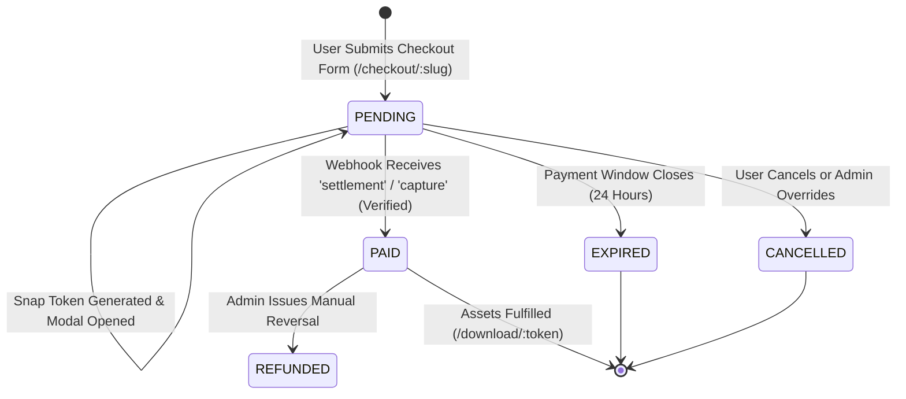

# IPD: Integration & Payment Gateway Design Document
**Project Name:** Kanidee Platform (Digital Health E-Commerce & Content Ecosystem)  
**Document Identifier:** KND-IPD-005  
**Version:** 2.0.0-ENTERPRISE  
**Date:** October 2026  
**Author Role:** Senior Principal Payment Systems & Integration Architect  
**Payment Gateway Provider:** Midtrans Indonesia (Primary Production Rails)  
**Fallback Capability:** Xendit Unified Adapter Pattern  
**Classification:** Confidential / Client Engineering Specification  

---

## 1. Indonesian Payment Ecosystem Architecture

To fully surpass `lynk.id`, Kanidee connects natively to the **Midtrans Snap v2 & Core API** engine. This eliminates the 2% to 5% commission surcharge historically extracted by link-in-bio storefronts, while giving the client direct access to the entire spectrum of Indonesian retail payment channels:

```
┌─────────────────────────────────────────────────────────────────────────────────┐
│                          SUPPORTED PAYMENT RAILS MATRIX                         │
├─────────────────────┬─────────────────────────────────────┬─────────────────────┤
│ Channel Category    │ Participating Banks / Wallets       │ Settlement Speed    │
├─────────────────────┼─────────────────────────────────────┼─────────────────────┤
│ QRIS 2.0 (Dynamic)  │ BCA Mobile, Livin by Mandiri, BRImo,│ Real-time (Instant) │
│                     │ BNI Mobile, GoPay, OVO, DANA,       │ Fee: 0.7% (BI MDR)  │
│                     │ ShopeePay, LinkAja                  │                     │
├─────────────────────┼─────────────────────────────────────┼─────────────────────┤
│ Virtual Accounts    │ BCA, Bank Mandiri, BRI, BNI,        │ Real-time callback  │
│ (Closed Dynamic)    │ Bank Permata, CIMB Niaga            │ Fixed flat fee/trx  │
├─────────────────────┼─────────────────────────────────────┼─────────────────────┤
│ Digital E-Wallets   │ Direct Deeplinking: GoPay,          │ Real-time (Instant) │
│                     │ ShopeePay App                       │                     │
├─────────────────────┼─────────────────────────────────────┼─────────────────────┤
│ Credit / Debit Card │ Visa, Mastercard, JCB, Amex         │ 3D-Secure 2.0 OTP   │
└─────────────────────┴─────────────────────────────────────┴─────────────────────┘
```

---

## 2. End-to-End Payment State Machine



---

## 3. Server-to-Server Token Generation API (`/api/checkout/route.ts`)

When a customer fills out the frictionless checkout form and clicks *"Bayar Sekarang"*, the server generates an authenticated Midtrans Snap transaction token. The Server Key is kept completely hidden on the backend:

```typescript
import { NextRequest, NextResponse } from 'next/server';
import { z } from 'zod';
import { prisma } from '@/lib/db';
import { env } from '@/lib/env';

// 1. Strict Input Validation Schema
const checkoutInputSchema = z.object({
  productSlug: z.string().min(1),
  customerName: z.string().min(2).max(100),
  customerPhone: z.string().regex(/^(?:\+62|62|0)8[1-9][0-9]{7,10}$/, 'Format nomor WhatsApp tidak valid'),
  customerEmail: z.string().email('Format email tidak valid'),
  voucherCode: z.string().optional(),
  notes: z.string().max(500).optional(),
}).strict();

export async function POST(req: NextRequest) {
  try {
    const rawBody = await req.json();
    const validatedData = checkoutInputSchema.parse(rawBody);

    // 2. Locate Product in Database
    const product = await prisma.product.findUnique({
      where: { slug: validatedData.productSlug, isActive: true },
    });

    if (!product) {
      return NextResponse.json({ message: 'Produk tidak ditemukan atau tidak aktif' }, { status: 404 });
    }

    let finalAmount = product.price;
    let discountAmount = 0;

    // 3. Evaluate Voucher if Provided
    if (validatedData.voucherCode) {
      const voucher = await prisma.voucher.findUnique({
        where: { code: validatedData.voucherCode.toUpperCase(), isActive: true },
      });

      if (voucher && (!voucher.validUntil || voucher.validUntil > new Date()) && voucher.currentUses < voucher.maxUses) {
        if (voucher.discountType === 'FIXED') {
          discountAmount = voucher.discountValue;
        } else if (voucher.discountType === 'PERCENTAGE') {
          discountAmount = Math.round((product.price * voucher.discountValue) / 100);
        }
        finalAmount = Math.max(1000, product.price - discountAmount); // Minimum 1000 IDR for gateway
      }
    }

    // 4. Generate Unique Public Invoice Order Number
    const timestamp = new Date().toISOString().slice(0, 10).replace(/-/g, '');
    const randomSuffix = Math.floor(1000 + Math.random() * 9000);
    const orderNumber = `KND-${timestamp}-${randomSuffix}`;

    // 5. Persist Order in PENDING State inside Database
    const order = await prisma.order.create({
      data: {
        orderNumber,
        customerName: validatedData.customerName,
        customerPhone: validatedData.customerPhone,
        customerEmail: validatedData.customerEmail,
        subtotal: product.price,
        discountAmount,
        totalAmount: finalAmount,
        status: 'PENDING',
        voucherCode: validatedData.voucherCode,
        notes: validatedData.notes,
        orderItems: {
          create: {
            productId: product.id,
            title: product.title,
            price: product.price,
            quantity: 1,
          },
        },
      },
    });

    // 6. Request Snap Token from Midtrans Server-to-Server
    const authString = Buffer.from(`${env.MIDTRANS_SERVER_KEY}:`).toString('base64');
    const midtransPayload = {
      transaction_details: {
        order_id: orderNumber,
        gross_amount: finalAmount,
      },
      customer_details: {
        first_name: validatedData.customerName,
        email: validatedData.customerEmail,
        phone: validatedData.customerPhone,
      },
      item_details: [
        {
          id: product.id,
          price: finalAmount,
          quantity: 1,
          name: product.title.slice(0, 50),
        },
      ],
      callbacks: {
        finish: `${env.NEXT_PUBLIC_APP_URL}/pesanan/${orderNumber}`,
      },
    };

    const snapEndpoint = env.MIDTRANS_IS_PRODUCTION
      ? 'https://app.midtrans.com/snap/v1/transactions'
      : 'https://app.sandbox.midtrans.com/snap/v1/transactions';

    const midtransResponse = await fetch(snapEndpoint, {
      method: 'POST',
      headers: {
        'Accept': 'application/json',
        'Content-Type': 'application/json',
        'Authorization': `Basic ${authString}`,
      },
      body: JSON.stringify(midtransPayload),
    });

    if (!midtransResponse.ok) {
      const errText = await midtransResponse.text();
      console.error('[MIDTRANS_SNAP_FAIL]', errText);
      return NextResponse.json({ message: 'Gagal menghubungi gateway pembayaran' }, { status: 502 });
    }

    const snapResult = await midtransResponse.json();

    // 7. Store Transaction Reference
    await prisma.paymentTransaction.create({
      data: {
        orderId: order.id,
        gatewayProvider: 'MIDTRANS',
        gatewayReferenceId: orderNumber,
        grossAmount: finalAmount,
        transactionStatus: 'pending',
      },
    });

    return NextResponse.json({
      orderNumber,
      token: snapResult.token,
      redirectUrl: snapResult.redirect_url,
    });
  } catch (error) {
    if (error instanceof z.ZodError) {
      return NextResponse.json({ message: 'Validasi form gagal', errors: error.issues }, { status: 400 });
    }
    console.error('[CHECKOUT_EXCEPTION]', error);
    return NextResponse.json({ message: 'Internal Server Error' }, { status: 500 });
  }
}
```

---

## 4. Cryptographic Webhook Security (HMAC SHA-512)

Midtrans notifies our server asynchronously whenever a customer completes a payment. To defend against fake callbacks, replay attacks, or price tampering, the webhook validates an SHA-512 signature:

$$\text{Signature} = \text{SHA512}(\text{order\_id} + \text{status\_code} + \text{gross\_amount} + \text{MIDTRANS\_SERVER\_KEY})$$

### Production Webhook Route (`app/api/webhooks/payment/route.ts`)
```typescript
import { NextRequest, NextResponse } from 'next/server';
import crypto from 'crypto';
import { prisma } from '@/lib/db';
import { env } from '@/lib/env';

export async function POST(req: NextRequest) {
  try {
    const body = await req.json();
    const {
      order_id,
      status_code,
      gross_amount,
      signature_key,
      transaction_status,
      payment_type,
    } = body;

    // 1. Signature Verification
    const rawString = `${order_id}${status_code}${gross_amount}${env.MIDTRANS_SERVER_KEY}`;
    const computedSignature = crypto.createHash('sha512').update(rawString).digest('hex');

    if (signature_key !== computedSignature) {
      await prisma.securityAuditLog.create({
        data: {
          eventType: 'SIGNATURE_FAILED',
          ipAddress: req.headers.get('x-forwarded-for') || 'UNKNOWN',
          metadata: { order_id, signature_key },
        },
      });
      return NextResponse.json({ message: 'Invalid Signature' }, { status: 401 });
    }

    // 2. Fetch Order and Assert Price Integrity
    const order = await prisma.order.findUnique({
      where: { orderNumber: order_id },
      include: { orderItems: { include: { product: true } } },
    });

    if (!order) {
      return NextResponse.json({ message: 'Order Not Found' }, { status: 404 });
    }

    if (Math.round(Number(gross_amount)) !== order.totalAmount) {
      await prisma.securityAuditLog.create({
        data: {
          eventType: 'TAMPER_BLOCKED',
          metadata: { expected: order.totalAmount, received: gross_amount },
        },
      });
      return NextResponse.json({ message: 'Gross Amount Mismatch' }, { status: 400 });
    }

    // 3. Idempotent Settlement in ACID Transaction
    const isSuccess = transaction_status === 'settlement' || transaction_status === 'capture';

    if (isSuccess && order.status !== 'PAID') {
      await prisma.$transaction(async (tx) => {
        // Atomic status transition
        await tx.order.update({
          where: { id: order.id },
          data: { status: 'PAID' },
        });

        await tx.paymentTransaction.updateMany({
          where: { gatewayReferenceId: order_id },
          data: {
            transactionStatus: transaction_status,
            paymentType: payment_type,
            signatureVerified: true,
            paidAt: new Date(),
            rawPayload: body,
          },
        });

        // Increment voucher usage if applicable
        if (order.voucherCode) {
          await tx.voucher.updateMany({
            where: { code: order.voucherCode },
            data: { currentUses: { increment: 1 } },
          });
        }

        // Mint expiring download tokens (Menu Download fulfillment)
        for (const item of order.orderItems) {
          if (item.product.productType === 'DIGITAL_EBOOK') {
            await tx.downloadAccess.create({
              data: {
                orderId: order.id,
                productId: item.productId,
                expiresAt: new Date(Date.now() + 72 * 60 * 60 * 1000), // 72 Hours validity
              },
            });
          }
        }
      });
    }

    return NextResponse.json({ status: 'OK' });
  } catch (error) {
    console.error('[WEBHOOK_EXCEPTION]', error);
    return NextResponse.json({ message: 'Internal Server Error' }, { status: 500 });
  }
}
```

---

## 5. Client Hook: `useMidtransSnap.ts`

```typescript
'use client';

import { useEffect, useState, useCallback } from 'react';

declare global {
  interface Window {
    snap?: {
      pay: (
        token: string,
        options: {
          onSuccess?: (result: unknown) => void;
          onPending?: (result: unknown) => void;
          onError?: (result: unknown) => void;
          onClose?: () => void;
        }
      ) => void;
    };
  }
}

export function useMidtransSnap() {
  const [isLoaded, setIsLoaded] = useState(false);

  useEffect(() => {
    const clientKey = process.env.NEXT_PUBLIC_MIDTRANS_CLIENT_KEY;
    const snapUrl = process.env.NEXT_PUBLIC_MIDTRANS_SNAP_URL || 'https://app.sandbox.midtrans.com/snap/snap.js';

    if (document.getElementById('midtrans-snap-script')) {
      setIsLoaded(true);
      return;
    }

    const script = document.createElement('script');
    script.id = 'midtrans-snap-script';
    script.src = snapUrl;
    script.setAttribute('data-client-key', clientKey || '');
    script.async = true;
    script.onload = () => setIsLoaded(true);

    document.body.appendChild(script);
  }, []);

  const openSnapModal = useCallback(
    (
      token: string,
      callbacks: {
        onSuccess?: (result: unknown) => void;
        onPending?: (result: unknown) => void;
        onError?: (result: unknown) => void;
        onClose?: () => void;
      }
    ) => {
      if (!window.snap) {
        console.error('Midtrans Snap is not loaded yet');
        return;
      }
      window.snap.pay(token, callbacks);
    },
    []
  );

  return { isLoaded, openSnapModal };
}
```
