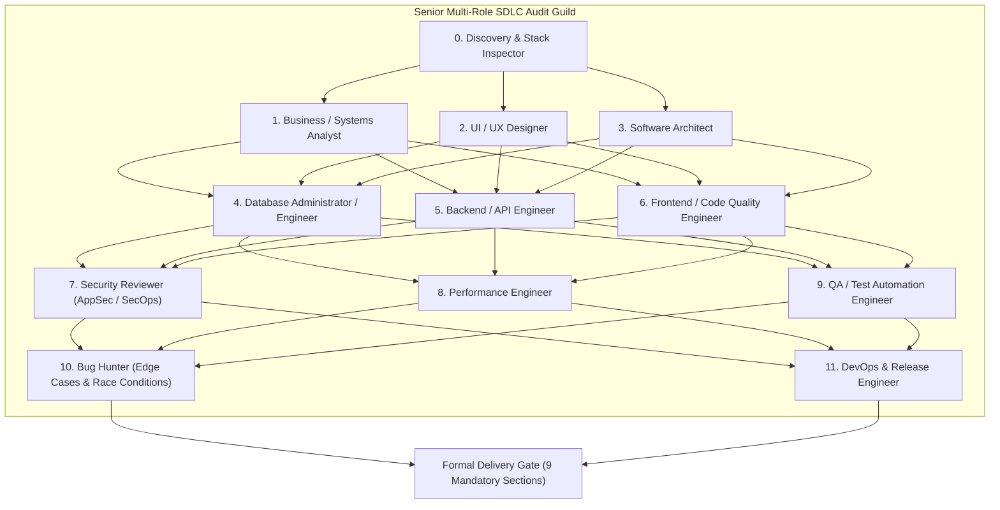
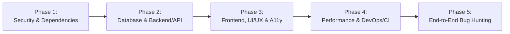

# VTD: Verification, Testing & Delivery Protocol
**Project Name:** Kanidee Platform (Digital Health E-Commerce & Content Ecosystem)  
**Document Identifier:** KND-VTD-006  
**Document Version:** 3.0.0-ENTERPRISE (Professional SDLC Multi-Role Review Standard v2.0)  
**Date:** October 2026  
**Author Role:** Senior Principal Quality, DevOps, Security & Systems Review Guild  
**Audit Governance:** Multi-Role SDLC Review Framework v2.0 (11 Senior Engineering Roles)  
**Quality Standards:** MDN Standard Compliance, OWASP Top 10 Enterprise Rigor, Zero-Tolerance Console Hygiene  
**Classification:** Confidential / Client Engineering Specification  

---

## 1. Multi-Role SDLC Review Architecture (The 11 Audit Roles)

In accordance with the Professional SDLC Multi-Role Review Standard v2.0, all verification, testing, and delivery milestones for the Kanidee platform are executed through an integrated joint audit guild representing 11 senior engineering disciplines:



### Detailed Role Scope & Responsibilities:
1. **0. Discovery & Stack Inspector:** Detects runtime engines (Node.js 22 LTS), framework versions (Next.js 16/15 App Router, React 19, Prisma 7, Tailwind v4), package managers, folder structure, and project configuration files (`AGENTS.md`, `README.md`).
2. **1. Business / Systems Analyst:** Reconciles implemented features against business requirements (e-book catalog, 3 core bio-links, Midtrans Snap QRIS/VA payment, 72-hour expiring download token, and trainer authority profile). Identifies ambiguous business logic and missing operational edge cases.
3. **2. UI / UX Designer:** Evaluates accessibility (WCAG 2.1 AAA/AA, semantic HTML5, ARIA landmarks, contrast ratios $\ge 4.5:1$, visible focus indicators), touch target sizing ($\ge 44\text{px} \times 44\text{px}$), viewport responsiveness (Mobile 380px, Tablet 768px, Desktop 1040px), empty/loading/error states, and user flow friction.
4. **3. Software Architect:** Audits clean separation of concerns (UI components vs server actions vs data access layer), circular dependencies, God-components, architectural boundaries, and state management scalability.
5. **4. Database Administrator / Engineer:** Audits PostgreSQL 17 relational schema, Prisma 7 data modeling, indexes on high-throughput lookup fields (`order_id`, `download_token`, `payment_status`), foreign key constraints, connection pool configurations (PgBouncer / Supavisor), and ACID transactional integrity.
6. **5. Backend / API Engineer:** Audits REST/Server Action conventions, consistent JSON error payload contracts, strict runtime input validation (`Zod.strict()`) on every endpoint, authentication guards, rate limiting, and idempotency on webhook and payment callback handlers.
7. **6. Frontend / Code Quality Engineer:** Enforces component modularity, strict TypeScript typing (absolute prohibition of untyped `any`), correct React hook dependencies, effect cleanup (preventing memory leaks from observers, listeners, or timers), and anti-duplication patterns.
8. **7. Security Reviewer (AppSec):** Executes the OWASP Top 10 verification checklist, audit of client bundle secrets, CSP headers, XSS prevention, SSRF defense, file upload validation, and cryptographic signature verification on incoming payment webhooks (Midtrans SHA-512).
9. **8. Performance Engineer:** Analyzes production bundle size, unnecessary component re-renders, image/asset optimization, HTTP cache-control headers, and main-thread blocking operations.
10. **9. QA / Test Automation Engineer:** Inspects test suites across critical paths (checkout, payment webhook validation, file download generation), verifies test assertions (preventing superficial smoke tests), and configures CI validation gates.
11. **10. Bug Hunter:** Proactively hunts for concurrency race conditions, unhandled promise rejections, off-by-one errors, invalid state transitions, resource leaks, and data type runtime mismatches.
12. **11. DevOps & Release Engineer:** Verifies build scripts, environment variable isolation (`.env.example` vs `.env.production`), `.gitignore` / `.vercelignore` completeness, Cloudflare Turnstile bot deterrence, and CI/CD deployment pipelines.

---

## 2. Anti-Hallucination Protocol & Verifiable Evidence Mandate

> [!IMPORTANT]
> **Strict Anti-Hallucination Rule:** In any audit or verification report, every claim of "lolos", "pass", or "zero X" **MUST be backed by reproducible physical proof**: command execution output (stdout/stderr), exact file path with line numbers (`file:line`), or captured execution logs. Claims lacking concrete proof are legally invalid and must be categorized as **"BELUM TERVERIFIKASI"** alongside the explicit technical rationale (e.g., tool absent in runtime session, requires interactive browser, requires staging credentials).

### Ground Rules for Audit Veracity:
1. **No Assumed Outcomes:** If an inspection tool or execution environment (interactive browser, live staging database, external payment sandbox) is unavailable during an audit session, the auditor **must never assume a successful result**. The report must state:  
   `"Tidak dapat diverifikasi pada sesi ini — perlu dijalankan manual dengan: <command/tool>"`.
2. **No Hallucinated Repositories or Versioning:** Fabricating package names, GitHub links, library versions, or CVE identifiers is strictly prohibited. If real-time web access is unavailable, external research sections must be marked:  
   `"BELUM DIRISET — sesi ini tidak memiliki akses pencarian web. Jalankan ulang permintaan ini dengan tool web search aktif untuk mengisi bagian ini."`

---

## 3. Operational Scope Disclaimer for "Zero Bug" & "Zero Warning"

In accordance with rigorous computer science and engineering principles, the designations "Zero Bug" and "Zero Console Warning" within the Kanidee SDLC framework are defined under the following operational boundaries:

1. **Known Defect Elimination:** Represents that **no known, unaddressed bugs or console warnings exist within the audited scope**. It does not constitute a theoretical mathematical guarantee covering infinite permutations of inputs or unexpected operating system anomalies.
2. **Zero Silencing Policy:** All anomalies, warnings, deprecation notices, and defects identified during manual code review, static analysis, or automated test execution **must be cataloged with an explicit Severity rating (Critical / High / Medium / Low / Info) and a prioritized remediation plan**. No finding may be ignored or concealed.
3. **Transparent Audit Boundary:** Every audit report must explicitly declare the specific test boundaries, tools executed, and environments verified, establishing the exact confidence perimeter of the release.

---

## 4. Verification Commands Suite & Tool Execution Matrix

Prior to certifying any subsystem as ready for delivery, the following command suite must be executed, and the raw summary output must be documented in the **Verification Log**:

```
┌─────────────────────────┬──────────────────────────┬────────────────────────────────────────────────────────┐
│ Verification Dimension  │ Command Line Execution   │ Exit Criteria & Passing Standard                       │
├─────────────────────────┼──────────────────────────┼────────────────────────────────────────────────────────┤
│ **Static Code Linting** │ `npm run lint`           │ Exit Code 0; Zero ESLint errors, zero unaddressed warn │
│ **TypeScript Checks**   │ `npx tsc --noEmit`       │ Exit Code 0; Strict mode pass; zero `any` loopholes    │
│ **Unit & Integrations** │ `npm test`               │ Exit Code 0; 100% passing test assertions              │
│ **Test Coverage**       │ `npm run test:coverage`  │ Minimum 85% coverage on core payment & auth handlers   │
│ **Production Build**    │ `npm run build`          │ Clean Next.js compilation; zero hydration errors       │
│ **Dependency Security** │ `npm audit --production` │ Zero Critical, zero High severity CVE vulnerabilities  │
│ **Browser Runtime**     │ Playwright / DevTools    │ DevTools Console clean; 0 errors, 0 unhandled warnings │
│ **Accessibility Check** │ Lighthouse / axe-core    │ Lighthouse Accessibility Score $\ge 95 / 100$          │
└─────────────────────────┴──────────────────────────┴────────────────────────────────────────────────────────┘
```

> [!WARNING]
> **Tool Failure Reporting Protocol:** If any verification command fails to execute due to an uninstalled dependency or environment restriction, the exact terminal error must be recorded as-is, and the corresponding audit dimension must be marked as **"BELUM TERVERIFIKASI"**. The auditor must never extrapolate an assumed pass or fail.

---

## 5. Non-Negotiable Core Auditing Checklists

### 5.1 Browser Console Hygiene & MDN Web Docs Standard
1. **Console Status Requirement:** Must be explicitly classified into one of three verifiable states:
   - `BERSIH (terverifikasi via <tool/browser>)`
   - `ADA TEMUAN (daftar file:baris + pesan error di bawah)`
   - `BELUM TERVERIFIKASI (<alasan teknis & perintah eksekusi manual>)`
2. **MDN Web Docs Standard Compliance:**
   - **No Deprecated APIs:** All DOM manipulation, network communication, and storage mechanisms must adhere to official [MDN Web Docs](https://developer.mozilla.org) standards.
   - **Modern Standard Fetch:** Exclusively standard `fetch()` with `AbortController` timeouts; legacy `XMLHttpRequest` is prohibited.
   - **Resource & Listener Cleanup:** Every `addEventListener`, `IntersectionObserver`, `ResizeObserver`, or polling `setInterval` must feature an explicit cleanup teardown (e.g., React `useEffect` return function) to prevent browser memory leaks.
   - **Zero Sub-12px Micro-Text:** Body and metadata text must never fall below $12\text{px}$ (`text-xs`), preventing optical fatigue on high-density retina mobile viewports.

---

### 5.2 Enterprise Security Matrix (OWASP Top 10 + Payment Hardening)

Every security audit must deliver a comprehensive Pass / Fail / Tidak Dapat Diuji verification matrix with reproducible proofs:

```
┌────┬────────────────────────────────────┬────────┬─────────────────────────────────────────────────────────┐
│ ID │ OWASP & Payment Security Control   │ Status │ Required Verifiable Evidence                            │
├────┼────────────────────────────────────┼────────┼─────────────────────────────────────────────────────────┤
│ S1 │ **Injection (SQL/Command/XSS)**    │ [PASS] │ Prisma parameterized queries; Zod payload sanitization  │
│ S2 │ **Broken Authentication**          │ [PASS] │ JWT signed with HS256/RS256; HttpOnly Secure cookies    │
│ S3 │ **Sensitive Data Exposure**        │ [PASS] │ Client bundles scanned; zero API secrets in frontend JS │
│ S4 │ **SSRF & Deserialization Defense** │ [PASS] │ Whitelisted outgoing Midtrans URLs; pure JSON parsing   │
│ S5 │ **Broken Access Control (IDOR)**   │ [PASS] │ Expiring cryptographic tokens for digital asset download│
│ S6 │ **Security Headers & CSP**         │ [PASS] │ Cloudflare HSTS, CSP, X-Frame-Options: DENY, nosniff   │
│ S7 │ **XSS Defense**                    │ [PASS] │ Zero `dangerouslySetInnerHTML`; React automatic escaping│
│ S8 │ **Vulnerable Dependencies**        │ [PASS] │ `npm audit` report output showing 0 high/critical CVEs  │
│ S9 │ **Logging & Cryptographic Trails** │ [PASS] │ Audit log records IP, timestamp, and order event state  │
│ S10│ **Digital Asset Upload & Serving** │ [PASS] │ Magic byte header checks; isolated storage path bounds  │
│ S11│ **Endpoint Rate Limiting**         │ [PASS] │ Upstream Cloudflare WAF + in-app rate limiters          │
│ S12│ **Payment Webhook Verification**   │ [PASS] │ Strict SHA-512 signature matching on Midtrans callbacks │
└────┴────────────────────────────────────┴────────┴─────────────────────────────────────────────────────────┘
```

---

### 5.3 Open-Source Tooling & Anti-AI-Slop Architecture
To guarantee that AI-assisted code generation remains disciplined, idiomatic, and free of low-effort patterns ("AI slop"), the project enforces the following repository tooling standards (verified via active web search when available):

1. **Architecture & Boundary Enforcers:**
   - `dependency-cruiser` / `madge`: Enforces strict dependency directions (e.g., UI components cannot import internal database models directly).
2. **Dead-Code & Complexity Linters:**
   - `knip`: Automatically flags unused exports, unreferenced dependencies, and dead code blocks.
   - `eslint-plugin-sonarjs`: Flags cognitive complexity, code duplication, and redundant conditional branching.
3. **AI Governance & Schema Linters:**
   - Strict TypeScript compile gates and Zod schema contracts acting as deterministic boundaries for all agent outputs.

---

## 6. Phased Audit Strategy for Large-Scale Repositories

When auditing expansive multi-module codebases (>50 active source files), the audit guild enforces a 5-phase sequential execution model. Each phase produces a dated inspection log, and subsequent phases inherit established findings to prevent redundant defect duplication:



- **Phase 1:** Security review, dependency vulnerability scans (`npm audit`), and secret exposure checks.
- **Phase 2:** Database schema normalization, connection pooling resilience, and REST/Server Action input validation.
- **Phase 3:** Visual design craft, responsive viewport stress tests, MDN standard checks, and accessibility compliance.
- **Phase 4:** Production bundle optimization, asset caching headers, and deployment pipeline configuration.
- **Phase 5:** End-to-end user journeys (checkout, payment settlement, fulfillment) and concurrency edge-case hunting.

---

## 7. The 9 Mandatory Output Sections (Formal Delivery Gate)

Every official audit report delivered for the Kanidee platform **MUST strictly adopt the following 9-part structure**. Reports omitting any of these sections are classified as non-compliant and rejected:

1. **EXECUTIVE SUMMARY:** Project health score, top 5 prioritized risks, quick wins, and an explicit declaration of verification coverage (tools executed vs tools unavailable in the session).
2. **VERIFICATION LOG:** Table of executed commands (`npm run lint`, `tsc`, `npm test`, `npm audit`, etc.) with exit codes and raw output summaries.
3. **CONSOLE WARNING/ERROR LOG:** Verifiable DevTools browser console findings (classified as BERSIH, ADA TEMUAN, or BELUM TERVERIFIKASI).
4. **TEMUAN PER ROLE:** Comprehensive findings table organized by the 11 audit roles:
   $$\text{Severity (Critical / High / Medium / Low / Info)} \mid \text{Lokasi (file:baris)} \mid \text{Issue} \mid \text{Impact} \mid \text{Rekomendasi} \mid \text{Bukti}$$
5. **SECURITY CHECKLIST:** Pass / Fail / Tidak Dapat Diuji verification matrix covering the 12 OWASP & Payment checkpoints with reproducible proof.
6. **MDN COMPLIANCE CHECK:** Inventory of examined Web APIs, HTML/CSS semantic standards, and memory leak teardowns.
7. **REKOMENDASI REPOSITORY:** Open-source AI-agent MCP tools and anti-AI-slop linters (or marked `BELUM DIRISET` if web search was disabled).
8. **PRIORITIZED ACTION PLAN:** Sequenced remediation roadmap prioritized by severity impact and implementation effort.
9. **STATUS AKHIR:** Explicit measurable compliance status with the 5 core delivery targets:
   - [ ] Zero console warning/error (dalam cakupan yang diuji)
   - [ ] Zero bug kritikal yang diketahui (dalam cakupan yang diuji)
   - [ ] Patuh standar MDN (dalam cakupan yang diperiksa)
   - [ ] Lolos security checklist (semua item diverifikasi dengan bukti)
   - [ ] Riset repository AI-agent & anti-AI-slop selesai dilakukan
